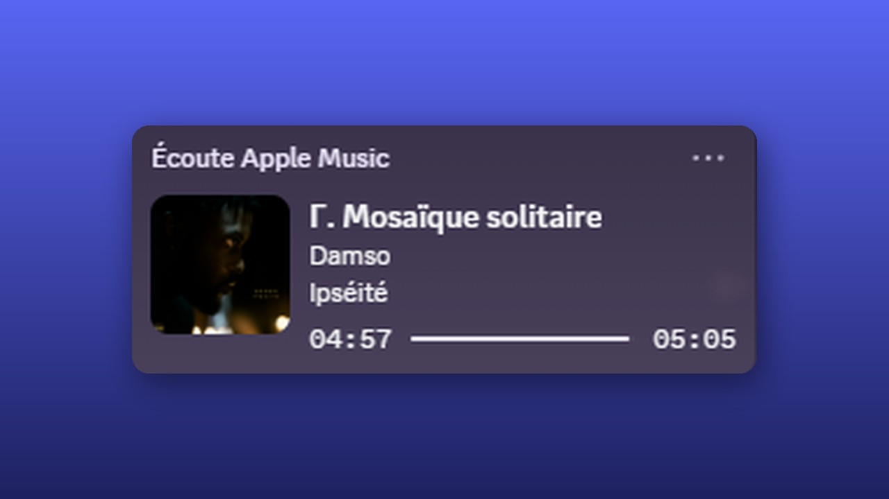
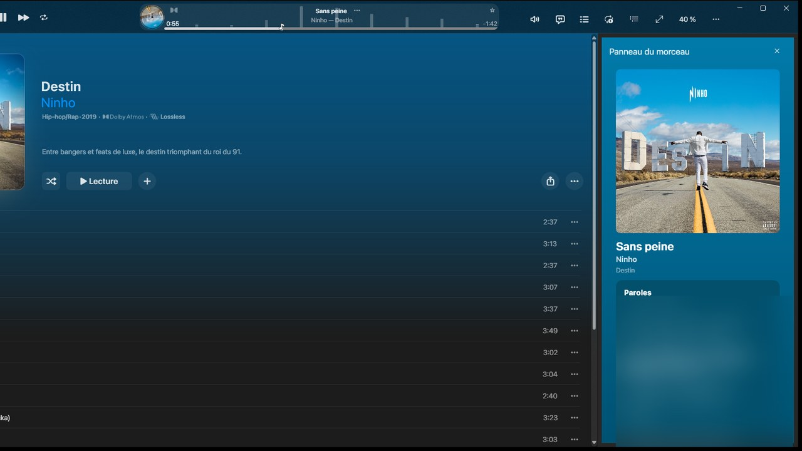
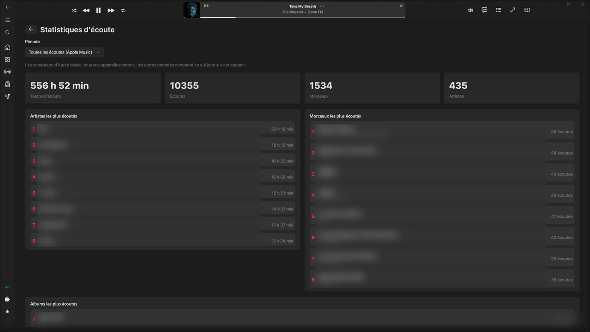
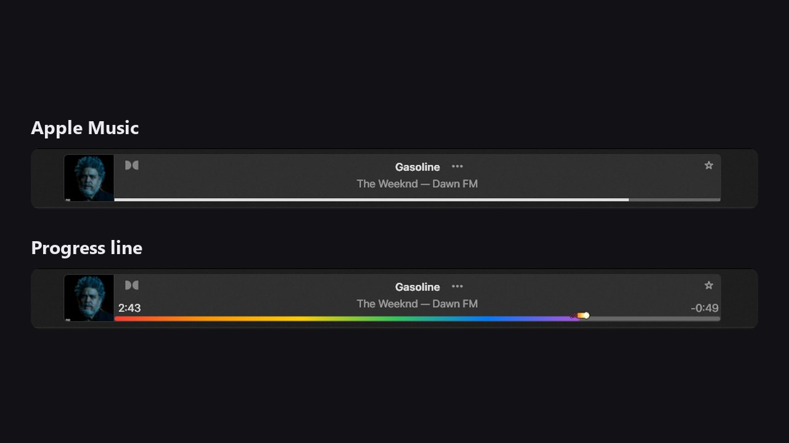

<div align="center">


# Ampify

**Themes, extensions and a Marketplace for Apple Music on Windows.**

The official Apple Music app, dressed and extended the way Spicetify does it for Spotify. Lossless, Dolby Atmos,
lyrics, your library and its sync all keep working.

[](https://github.com/Shirowwww/ampify/releases/latest)
[](https://github.com/Shirowwww/ampify/releases)

[](LICENSE)

### [Download](https://github.com/Shirowwww/ampify/releases/latest) &nbsp;·&nbsp; [Website](https://shirowwww.github.io/ampify/) &nbsp;·&nbsp; [Themes](https://shirowwww.github.io/ampify/themes.html) &nbsp;·&nbsp; [Docs](https://shirowwww.github.io/ampify/documentation.html)


</div>

## What people install it for

<table>
<tr>
<td width="50%" valign="top"><br>
<b>Themes and a Marketplace.</b> Ten themes, from Apple's own Liquid Glass to a Windows 11 look, and 28 colour
schemes. Pick one in the Marketplace inside Apple Music and it is on at once, no restart.</td>
<td width="50%" valign="top"><br>
<b>Discord and Last.fm.</b> Your Discord status shows the song, its artwork, the album and a progress bar. A
scrobbler sends what you play to Last.fm. Both are one click away in the Marketplace.</td>
</tr>
<tr>
<td valign="top"><br>
<b>Lyrics word by word.</b> The Song panel slides over the window with a large artwork, lyrics that light up word by
word, the credits and what plays next. The Now Playing button opens Apple's full-screen player, karaoke lyrics
included.</td>
<td valign="top"><br>
<b>Your listening stats.</b> Hours listened, plays, your top artists, songs and albums, over all time or a
period. A second page lists the new releases of the artists you play.</td>
</tr>
<tr>
<td valign="top"><br>
<b>A playback bar of your own.</b> At the top, the bottom or centred under any theme. Snippets add a thicker
progress line with the time under the pointer, an equalizer that moves with the music, a spinning record.</td>
<td valign="top"><br>
<b>Everything in Apple Music's settings.</b> Five tabs and a search box that finds any setting. Extensions add an
A-B loop, a sleep timer, global shortcuts, bookmarks, a skip list, and an Atmos leveler that plays Dolby Atmos
songs as loud as stereo ones.</td>
</tr>
</table>

## What you get

| Change the look | Add what is missing | Keep it safe |
|---|---|---|
| 10 themes and 28 colour schemes, light and dark, switched without a restart | Discord presence, Last.fm scrobbling, a sleep timer, global shortcuts, an A-B loop | Nothing is written into Apple Music's package: uninstall and the original app is back |
| 11 snippets to layer on any theme: corners, lyrics style, artwork filters, an equalizer that moves with the music | Pages for your listening stats and the new releases of the artists you play | Every extension lists its permissions before you switch it on |
| One accent colour of your choice, or the colours of the song playing | A Song panel, the time under the pointer on the progress line, a full-screen player with karaoke lyrics, and an Atmos leveler that plays Dolby Atmos songs as loud as stereo ones | A new Apple Music version stays untouched until Ampify has been tested on it |
| The playback bar at the top, the bottom or centred, under every theme | A Marketplace inside Apple Music, one click to install | Updates check their SHA-256 and install while Apple Music is closed |

Ampify speaks English, French, German, Spanish, Portuguese, Russian, Japanese, Simplified Chinese, Italian and Korean.
Spicetify `color.ini` palettes work as they are.

### New in 1.3

A new installer and uninstaller with a window of their own. A settings page in five tabs, with a search box that finds
any setting. Fewer snippets with more settings each, and your choices carry over. One place for the playback bar under
every theme. Liquid glass for Glass, and colour filters for the artwork. 1.3.1 and 1.3.2 fix the sidebar that opens
under the pointer, theme colours in the playback bar and the song panel in narrow windows. The full list is in the
[changelog](CHANGELOG.md).

## Install

You need Windows 10 or 11 (x64) and Apple Music from the Microsoft Store.

1. Close Apple Music, including its icon in the notification area next to the clock.
2. Download `ampify-<version>-windows-x64.zip` from the [latest release](https://github.com/Shirowwww/ampify/releases/latest).
3. Extract the whole zip (right-click, Extract All) and double-click `ampify_setup.exe` in the new folder. It will not
   run from inside the zip.

Or paste one line in PowerShell. It downloads the latest release, checks its SHA-256 and installs it for your Windows
account, without administrator rights:

```powershell
irm https://raw.githubusercontent.com/Shirowwww/ampify/main/scripts/install.ps1 | iex
```

<details>
<summary>Read the script before it runs</summary>

```powershell
irm https://raw.githubusercontent.com/Shirowwww/ampify/main/scripts/install.ps1 -OutFile install.ps1
notepad install.ps1
powershell -ExecutionPolicy Bypass -File install.ps1
```

</details>

Then open Apple Music from its own icon, as usual.

> [!WARNING]
> Windows Defender or SmartScreen may warn about a file. The programs are not code-signed yet, and the launcher loads
> Ampify's DLL into Apple Music, which some malware also does. Each release is scanned with Microsoft Defender before
> it is published and its SHA-256 is on the release page, so the warning is a false positive. Allow the file Defender
> names (SmartScreen: "More info", then "Run anyway"), or build Ampify from source. Never switch protection off.

## Your first five minutes

Right after the install, Apple Music looks the same: no theme is on yet.

1. Click **Ampify** at the bottom of the sidebar. The Marketplace opens.
2. Under **Themes**, click **Install** on one you like. It is in use at once.
3. Open Apple Music's **Settings > Ampify** to switch extensions on, pick an accent or move the playback bar.

**Use Apple Music's look**, at the bottom of the themes, brings the original look back. Every other way back, up to a
full uninstall, is in [Getting started](https://shirowwww.github.io/ampify/getting-started.html#go-back-to-apple-music).

Everything also works from a terminal:

```
ampify install glass                      # get a theme from the Marketplace
ampify theme set glass --scheme Light     # use it
ampify theme clear                        # back to Apple Music's look
ampify install sleep-timer                # get an extension
ampify doctor                             # check that everything is in order
ampify report                             # an anonymous report to attach to an issue
```

The [command line](https://shirowwww.github.io/ampify/cli.html) page lists every command and setting.

## Make your own

A theme is a folder of text files. An extension is one JavaScript file (TypeScript and JSX work too) and a manifest.
Three commands take you from nothing to the Marketplace:

```
ampify new theme my-theme      # a starter that already runs (or extension, snippet, app)
ampify dev my-theme            # Apple Music reloads it each time you save
ampify publish my-theme        # checks it and opens a pull request on the catalog
```

Themes style Apple Music's zones by stable names such as `.sidebar`, `.playbar` or `.card`, in CSS you already know.
Extensions call the `Ampify` API for the player, menus, panels, storage and a set of ready-made components. Start with
[Create](https://shirowwww.github.io/ampify/create.html), then see how an element reaches the Marketplace in
[five steps](https://shirowwww.github.io/ampify/extensions/catalog.html#propose-an-element-in-five-steps).

## Documentation

| Use | Create | Work on Ampify |
|---|---|---|
| [Getting started](https://shirowwww.github.io/ampify/getting-started.html) | [Your first theme](https://shirowwww.github.io/ampify/themes/guide.html) | [Contributing](CONTRIBUTING.md) |
| [Command line](https://shirowwww.github.io/ampify/cli.html) | [Your first extension](https://shirowwww.github.io/ampify/extensions/guide.html) | [Building](https://shirowwww.github.io/ampify/development/building.html) |
| [Ampify, Spicetify and Cider](https://shirowwww.github.io/ampify/spicetify-parity.html) | [Theme format](https://shirowwww.github.io/ampify/themes/format.html) and [API](https://shirowwww.github.io/ampify/extensions/api.html) | [How it works](https://shirowwww.github.io/ampify/development/how-it-works.html) |
| [Changelog](CHANGELOG.md) | [All the docs](https://shirowwww.github.io/ampify/documentation.html) | [Issues](https://github.com/Shirowwww/ampify/issues) |

> [!NOTE]
> Ampify is experimental. Apple updates Apple Music on its own schedule, and an update can break something. Bug
> reports and pull requests are welcome: read [Contributing](CONTRIBUTING.md) or open an
> [issue](https://github.com/Shirowwww/ampify/issues).

## Build from source

Windows 10 or 11 x64, Visual Studio 2022 or later with the C++ workload, and the Windows SDK. Then run
`pwsh -File scripts\build-msvc.ps1`. [Building](https://shirowwww.github.io/ampify/development/building.html) has the
details.

## Support the project

Ampify is free and stays free. If it makes your music nicer, you can buy me a coffee:

[](https://ko-fi.com/shirowww)

## Credits and license

You can use, read and change Ampify under the [PolyForm Noncommercial License 1.0.0](LICENSE), for anything except
commercial use; any copy or fork keeps the credit line at the top of that file. What you make for Ampify is yours.
Themes, snippets, extensions and apps that only use its documented formats and the `Ampify` API are not covered by
Ampify's license, and their authors pick their own, commercial or not. The [examples](examples) and the starters made
by `ampify new` are under the [MIT license](examples/LICENSE).

Ampify builds on QuickJS-ng and on what AMExclusive learned about Apple Music's player. The full list is in
[CREDITS.md](CREDITS.md). Apple Music is a trademark of Apple Inc. Ampify is not affiliated with Apple.
