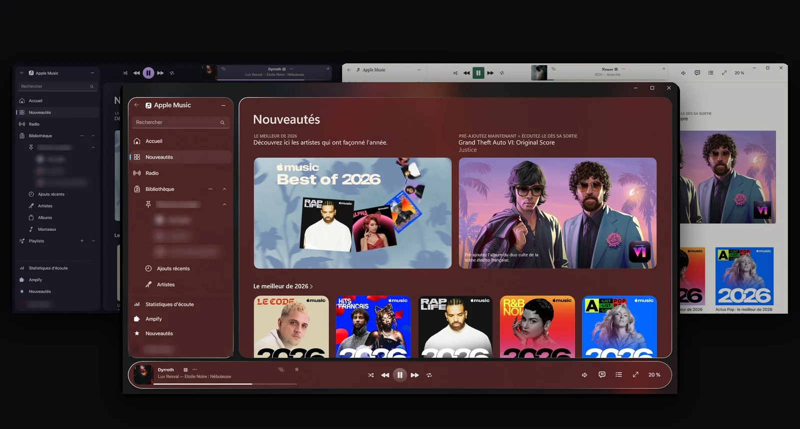
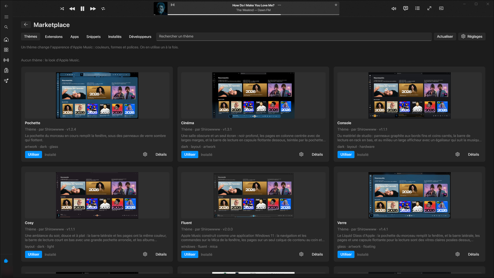
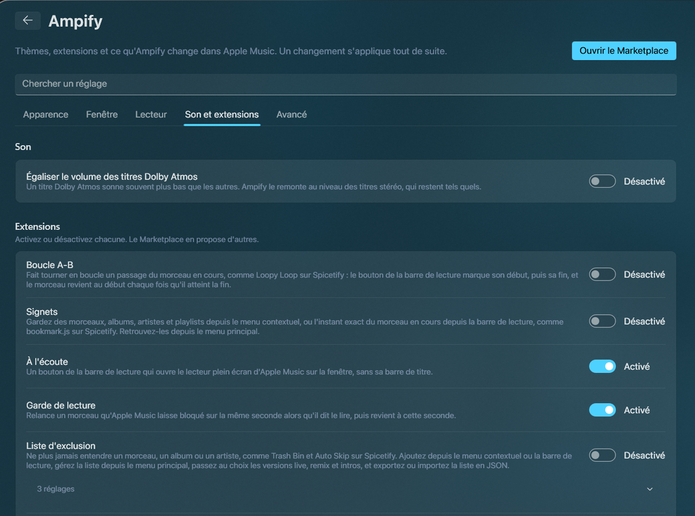

<div align="center">


# Ampify

**Themes, extensions and a Marketplace for Apple Music on Windows.**

Ampify does for the official Apple Music app what Spicetify does for Spotify. Change how it looks, add what it lacks,
and keep everything Apple Music already does: lossless, Dolby Atmos, lyrics, your library and sync.

[](https://github.com/Shirowwww/ampify/releases/latest)
[](https://github.com/Shirowwww/ampify/releases)

[](LICENSE)

### [Download](https://github.com/Shirowwww/ampify/releases/latest) &nbsp;·&nbsp; [Website](https://shirowwww.github.io/ampify/) &nbsp;·&nbsp; [Themes](https://shirowwww.github.io/ampify/themes.html) &nbsp;·&nbsp; [Docs](https://shirowwww.github.io/ampify/documentation.html)



</div>

> [!NOTE]
> Ampify is experimental. Apple updates Apple Music on its own schedule, so an update can break something. Bug reports
> and pull requests are welcome: see [Contributing](CONTRIBUTING.md) or open an [issue](https://github.com/Shirowwww/ampify/issues).

## What you get

- 11 themes with 27 colour schemes, light and dark, applied at once without a restart, and an accent colour of your
  choice. Spicetify `color.ini` palettes work as they are.
- A Marketplace inside Apple Music (the Ampify entry at the bottom of the sidebar) with themes, extensions and
  snippets, previews, and one-click installs.
- Extensions for Discord presence, Last.fm scrobbling, a sleep timer and global shortcuts, and pages for your
  listening stats and the new releases of the artists you listen to. Each one shows the permissions it needs before
  you switch it on.
- Now Playing (Apple's full-screen player with karaoke lyrics), an Atmos leveler that brings Dolby Atmos songs to the
  loudness of stereo ones, and a playback guard for songs Apple Music leaves stuck, all shipped with Ampify.
- English, French, German, Spanish, Portuguese, Russian, Japanese and Simplified Chinese.
- Updates install themselves while Apple Music is closed, or after a question, as you choose in Settings > Ampify.
- Nothing is written into Apple Music's package, and uninstalling gives the original app back. On an Apple Music
  version that was not tested, Ampify stays off.

<div align="center">
<table>
<tr>
<td align="center"><br><sub>Marketplace</sub></td>
<td align="center"><br><sub>Ampify in Apple Music's settings</sub></td>
</tr>
</table>
</div>

## Install

Close Apple Music, then paste this line in PowerShell:

```powershell
irm https://raw.githubusercontent.com/Shirowwww/ampify/main/scripts/install.ps1 | iex
```

It downloads the latest release, checks its SHA-256 and installs it for your Windows account, with no administrator
rights. Then open Apple Music as usual, from its own icon.

To read the script before it runs, save it, open it, then start it yourself:

```powershell
irm https://raw.githubusercontent.com/Shirowwww/ampify/main/scripts/install.ps1 -OutFile install.ps1
notepad install.ps1
powershell -ExecutionPolicy Bypass -File install.ps1
```

Or download `ampify-<version>-windows-x64.zip` from the [latest release](https://github.com/Shirowwww/ampify/releases/latest),
extract it and run `ampify_setup.exe`. You need Windows 10 or 11 (x64) and Apple Music from the Microsoft Store.

> [!WARNING]
> **Windows Defender or SmartScreen warns about a file?** The programs are not code-signed yet, and the launcher loads
> Ampify's DLL into Apple Music, which some malware also does. Each release is scanned with Microsoft Defender before it
> is published, and its SHA-256 is on the release page, so a warning is a false positive: allow the file Defender names
> (SmartScreen: "More info", then "Run anyway"), or build Ampify from source. Never switch protection off.

## Use it

1. Open Apple Music and click **Ampify** at the bottom of the sidebar.
2. Under **Themes**, click **Use this theme** on the one you like.
3. Switch extensions on and off in Apple Music's **Settings > Ampify**.

The same from a terminal:

```
ampify theme set glass --scheme Light     # use a theme
ampify theme clear                        # back to Apple Music's look
ampify install sleep-timer                # install from the Marketplace
ampify report                             # an anonymous diagnostic report, to attach to an issue
```

More in [Getting started](https://shirowwww.github.io/ampify/getting-started.html) and
[the command line](https://shirowwww.github.io/ampify/cli.html).

## Make your own

`ampify new theme my-theme` (or `extension`, `snippet`, `app`) writes a working starter, `ampify dev my-theme` reloads
it in Apple Music at every save (an extension can be TypeScript or JSX), and `ampify publish my-theme` sends it to the
[catalog](https://github.com/Shirowwww/ampify-catalog). Start with [Create](https://shirowwww.github.io/ampify/create.html).

## Documentation

| Use | Create | Work on Ampify |
|---|---|---|
| [Getting started](https://shirowwww.github.io/ampify/getting-started.html) | [Themes](https://shirowwww.github.io/ampify/themes/guide.html) | [Contributing](CONTRIBUTING.md) |
| [Command line](https://shirowwww.github.io/ampify/cli.html) | [Extensions](https://shirowwww.github.io/ampify/extensions/guide.html) | [Building](https://shirowwww.github.io/ampify/development/building.html) |
| [Spicetify and Cider](https://shirowwww.github.io/ampify/spicetify-parity.html) | [Publishing](https://shirowwww.github.io/ampify/extensions/catalog.html) | [How it works](https://shirowwww.github.io/ampify/development/how-it-works.html) |
| [Changelog](CHANGELOG.md) | [All the docs](https://shirowwww.github.io/ampify/documentation.html) | [Issues](https://github.com/Shirowwww/ampify/issues) |

## Build from source

Windows 10 or 11 x64, Visual Studio 2022 or later (C++ workload) and the Windows SDK, then
`pwsh -File scripts\build-msvc.ps1`. Details: [Building](https://shirowwww.github.io/ampify/development/building.html).

## Support the project

Ampify is free and stays free. If you want to help, you can buy me a coffee:

[](https://ko-fi.com/shirowww)

## Credits and license

Ampify is free to use, read and change under the [PolyForm Noncommercial License 1.0.0](LICENSE): anything except
commercial use, and any copy or fork keeps the credit line at the top of that file. What you make for it is yours:
themes, snippets, extensions and apps that only use Ampify's documented formats and `Ampify` API are not covered by
Ampify's license, and their authors choose their own, commercial or not. The [examples](examples) and the starters made
by `ampify new` are under the [MIT license](examples/LICENSE).

Ampify builds on QuickJS-ng and on what AMExclusive learned about Apple Music's player; full list in
[CREDITS.md](CREDITS.md). Apple Music is a trademark of Apple Inc. Ampify is not affiliated with Apple.
